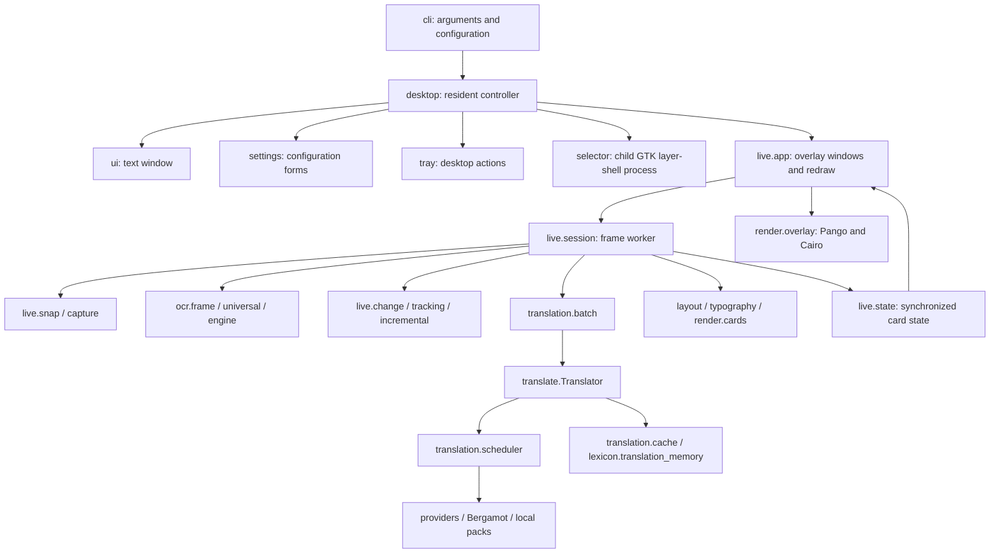

# Kizurium architecture

Baseline: the source tree at version 1.3.0, inspected 2026-10-18.
This document describes the code as it is. Earlier MAE/SSIM, word
completeness/precision and OCR timing figures are historical reports and are not
reproduced here; the only measurements below are synthetic helper microbenchmarks.

## 1. Responsibilities and actual technology

Kizurium captures a selected desktop region, recognizes text with existing
engines, translates it and paints input-transparent replacement cards. It also
provides a text translator, OCR clipboard actions, settings, tray actions,
diagnostics and local model management.

The UI is GTK4/PyGObject with gtk4-layer-shell; rendering uses Cairo and Pango.
Wayland layer-shell compositors (including wlroots/Hyprland) are the primary
overlay target. `capture.py` retains pre-existing KDE ScreenShot2 and XDG
ScreenCast/PipeWire paths; these are optional runtime branches, not a reason to
add KWin-specific dependencies. Other capture paths use grim and slurp.

**Selector:** the region selector is `gtk_selector.py`, launched by `selector.py`
as a child GTK layer-shell process. No QML or Quickshell code runs in this tree.
`flake.nix` still lists the `quickshell` package, which is a packaging leftover and
not a runtime dependency. Packaging declarations should not be confused with runtime
ownership. A second selector would duplicate the current protocol and lifecycle.

**Python baseline:** project metadata permits Python >=3.11; the reference
interpreter for the measurements below is 3.14.8. Python 3.15+ is a forward
compatibility target, not a verified installed runtime. Native build support
must be checked against upstream PyO3 before claiming that target is supported.
Pillow, numpy, pytesseract and requests are Python dependencies. OCR integrations
include RapidOCR/ONNX Runtime, Tesseract, Meiki and optional PaddleOCR. Translation
uses configured network providers, local CTranslate2 packs or Bergamot. SQLite
stores translation caches and curated translation memory.

## 2. Ownership and high-level graph



- `config.Config` is immutable validated configuration; load/save manages TOML.
- `paths.Paths` owns XDG filesystem locations and explicit environment overrides.
- `DesktopController` owns application windows, background pool, translator,
  model manager, tray and live session. Gio application actions provide IPC.
- `live.runtime` owns mutable live settings, active translator and bounded
  translation executor. `core.active` is another process-wide applied snapshot.
- `live.state.State` owns published cards, region, status, visibility and paint
  synchronization. Tracking objects carry block/content revisions.
- `Translator` owns provider options, cache, cancellation generation and local
  runtime references. Scheduler owns shared provider serialization/backoff and
  result identities. No second translation pipeline is planned.
- `fonts` and `typography.metrics` measure existing fonts; cards/layout construct
  render data. Their fitting behavior is outside the current modernization scope.

### Observed coupling and import cycles

AST inspection, including function-local and type-only imports, found these
strongly connected groups (not all are import-time failures):

| Group | Architectural implication |
|---|---|
| `cli ↔ desktop` | Controller constructs translators via CLI factory; CLI dispatches to controller. |
| `translate`, `translation.{bergamot,online,providers,scheduler,service}` | Backends, language helpers and result validation call across layers. |
| `core.text`, `lexicon.store`, `paths` | Text helpers and persistence paths are not completely independent. |
| `layout.name_gap ↔ typography.metrics` | Measurement and layout share helpers. |
| `live.reconcile`, `ocr.selection`, `ocr.universal` | OCR routing reaches into the live facade. |
| `ocr.postprocess ↔ ocr.roles`; `layout.grouping ↔ ocr.engine` | Recognition/postprocessing and grouping share classification helpers. |
| `live.app ↔ live.session` | Worker/module facade and window entry point are intertwined. |

`live` reexports names for compatibility and several modules intentionally import
late to avoid initialization cycles. Native kernels must depend on none of these
facades: only primitive buffers, dimensions and scalar parameters cross the FFI.

## 3. Lifecycle

1. `run.sh` chooses an interpreter and exposes `src`; console entry calls
   `cli.main`. CLI loads configuration, resolves overrides and dispatches
   headless diagnostics/model commands or resident desktop actions.
2. `desktop.run` creates/registers a Gio/GTK application. Subsequent action
   launches forward to its existing instance. Controller loads services and
   holds the application for the tray workflow.
3. Text/settings windows are created on demand. Region selection runs in a
   child GTK layer-shell process; request/result files and cancellation markers
   carry its existing protocol. Window-selection/capture branches are selected
   by environment capabilities.
4. Live startup creates session lock/pid files, synchronized state, a stop event
   and the `live-ocr` worker. GTK creates monitor-bound layer-shell windows and
   schedules redraws when state revisions change.
5. Configuration changes swap translators, cancel obsolete operations, bump
   scheduler revisions and apply snapshots. Appearance state is not recreated
   merely because the translation provider changes.
6. Stop closes live windows, signals cancellation and invalidates queued work.
   Quit cancels selection/model operations, closes translation services/helper
   processes, shuts down pools/tray and exits the application. Some pool shutdowns
   use `wait=False`: cancellation is cooperative and an already-running external
   call may finish later. This is not guaranteed immediate thread termination.

## 4. Frame and translation data flow

`capture.capture_image` produces a PIL image in the requested region.
`live.snap.clean_capture` hides cards, waits for the GTK empty-paint event,
requests a fresh frame where necessary and restores visibility as requested.
Cheap grayscale probes/change detection determine reuse or incremental work;
recognition remains in the existing OCR modules. Recognized dictionaries carry
text, local boxes, confidence, engine and language. Existing grouping/tracking
turns them into blocks with revisions. Batch translation checks glossary/cache,
queues provider operations and rejects obsolete identities. Layout/cards combine
translated strings with source geometry, font measurements and sampled colours.
The worker publishes dictionaries to `State`; GTK snapshots state and
`render.overlay.draw_blocks` paints Pango layouts through Cairo.

Screen geometry uses layout coordinates; PIL images and recognized boxes are
region-local pixels. Probes scale these to small grayscale images, and dirty
regions map back using source/probe ratios. Layer-shell monitor anchoring and
region offsets place windows in output space. Ordinary Wayland toplevel positions
are compositor-controlled and cannot be reliably restored by application code.

## 5. Concurrency and cancellation

- GTK/GLib owns widgets, window lifecycle, drawing callbacks, timers and D-Bus
  callbacks. UI mutation must stay on this thread.
- Controller uses a two-worker executor. `background` completes through
  `GLib.idle_add`; model notifications/status publishing use the same bridge.
- The live session has one long-lived worker; translation uses the shared bounded
  executor with `threads.budget` rather than a thread for each text block.
- Text window has its own bounded executor and latest-request generation.
- ModelManager has an owned single-worker executor, progress notifications and
  cancellation events. Bergamot helper reuses a loaded model in a subprocess;
  its JSON-lines protocol is serialized with a lock and bounded response timeout.
- `State` locks card publication; paint events synchronize capture with drawing.
  Frame queue is a single-slot buffer guarded by a condition. Both put and
  take occur in the same live worker; capture and OCR are sequential here, not
  independent producer/consumer threads. A queued-frame revision does not imply
  a fresh capture can arrive concurrently during recognition.
  Scheduler locks revisions/block identity, coalesces requests and protects
  provider queues; stop/generation checks prevent stale responses being applied.
- SQLite hot cache uses a lock plus thread-local connections and WAL. User
  credentials use keyring when available; provider options and logs must not
  expose secrets. Config, user dictionaries/model cache, runtime files and state
  logs have distinct XDG locations.

## 6. Rendering and UI boundaries

GTK4 widgets implement the text window/settings and selector toolbar. Layer-shell
is initialized before showing overlay windows; click-through is implemented by
empty input regions and no keyboard interactivity. Pango/Cairo rendering stays
in Python orchestration; the settings/main-window modernization will use themed
widgets and scoped CSS without changing card rendering, typography or capture
paint barriers. Quickshell has no rendering responsibility.

## 7. Performance assessment and native boundary

Full runtime profiling has not been completed. Existing cycle statistics measure
capture/OCR/translation/layout; they do not prove which Python loop dominates an
entire session. Known source-level costs suitable for isolated measurement:

- `live.change._tile_stats` repeatedly crops tiles, builds Pillow statistics and
  numpy arrays. Dirty-tile detection repeats similar work. At probe sizes the
  FFI/buffer-copy overhead must be measured, not assumed negligible.
- `ocr.preprocess.estimate_ink_height` performs a Python nested pixel scan;
  image resampling is already native Pillow. Moving recognition-related utilities
  is higher risk and is deferred until the simpler boundary is demonstrated.
- `measure_outside_change` allocates multiple numpy arrays/rolls and performs a
  Python connected-component walk; changing its classification is excluded.
- Typography/pixel masks and geometric loops are possible later candidates;
  Pango calls themselves are already native. ONNX, Tesseract, CTranslate2,
  Bergamot, Pillow, numpy, Cairo, Pango and SQLite already execute native code.

**Decision (implemented in 0.1 and 0.2):** one optional native extension with
isolated statistics kernels, subject to cost measurement and exact semantic checks.
No recognition heuristic, threshold, model or provider implementation moves.
A package-local Python adapter retains the existing call signatures and fallback.
The FFI accepts immutable contiguous byte buffers plus validated dimensions,
tile size and threshold; returns scalar statistics. It must avoid creating Python
objects per pixel/tile, use checked dimensions and release the GIL only over
owned/immutably borrowed data. Prefer safe Rust without custom unsafe/SIMD.

PyO3/maturin build compatibility, especially Python 3.15, must be verified from
upstream documentation before choosing versions. Keep the main Python package
installable without a Rust compiler; provide a separately built optional native
wheel and documented activation. Missing/incompatible extensions use Python;
invalid input must raise an explicit exception rather than silently masking a
native logic bug. Native packaging and final implemented APIs will be recorded
here after the ordered UI phase.

## 8. Risks and decisions

- Mutable process-wide snapshots can diverge; this work preserves ownership and
  does not add another configuration/translation manager.
- UI callbacks from executor threads must pass through GLib. Slow disk/native
  probing and shutdown waits can still stall the main loop if invoked directly.
- Single-instance application state is distinct from per-selection subprocesses;
  avoid spawning a second resident instance or a worker for each text block.
- SQLite connection cleanup, cooperative pool shutdown and helper timeout cleanup
  deserve targeted future audit; no unverified claim of leak-free shutdown.
- Python bytes conversion can cost more than small native kernels. Include it in
  microbenchmarks; avoid widening native scope without evidence.
- ABI mismatches/free-threading are distinct from normal GIL builds. Do not claim
  Python 3.15/free-threaded compatibility merely from a successful 3.14 build.
- The current UI and native work must not alter OCR recall/precision, run games,
  compare screenshots or start a full pytest/desktop integration campaign.

## 9. Implemented GTK4 modernization

The ordered documentation phase was completed before these UI changes.
`settings.py` now uses a themed HeaderBar and a compact six-page Gtk.Stack /
StackSwitcher (General, OCR, Translation, Models, Appearance, Advanced). Entries
and selectors use consistent grouped rows and standard theme borders. Request
interval, debounce and radius use numeric controls; config extraction uses their
numeric values rather than locale-dependent formatted strings. Initial values
outside the suggested UI ranges remain representable. All existing fields and
provider drafts remain available; no recognition setting has changed meaning.

`ui.py` uses system-theme foreground/background, a HeaderBar and symbolic actions.
Its text panes switch between horizontal and vertical layout below 640 logical
pixels, driven by the Gdk.Surface layout signal rather than a continuous tick.
The scoped stylesheet is installed once per display. Overlay CSS, Pango fitting,
click-through input regions and clean-capture paint events are unchanged.

`window_state.py` persists only settings/translator dimensions and maximization
in `$XDG_STATE_HOME/kizurium-translator/windows.json` (default ~/.local/state).
It tolerates corrupt/oversized files, uses atomic replacement, bounds restored
sizes to the available monitor and writes on close/shutdown rather than every
resize. Normal toplevel placement remains the compositor's responsibility;
monitor fallback before realization is best-effort, not a multi-monitor placement
guarantee. Settings are intentionally hidden/reused on close; app-owned listeners
therefore have the lifetime of the resident controller.

Limited verification: real GTK widget construction and mapping at 560×520;
provider draft preservation; numeric roundtrip (including noninteger radius and
request interval above the suggested range); state persistence and stylesheet
parsing. The system theme emits GtkGizmo slider minimum-size warnings. No game,
OCR benchmark, screenshot comparison or full pytest campaign was run for this
phase.

### Toolchain compatibility evidence

Upstream [PyO3 0.30.1 changelog](https://docs.rs/crate/pyo3/0.30.1/source/CHANGELOG.md)
includes Python 3.15 final support and requires Rust >=1.85. The available Rust
compiler is 1.99.1. [maturin configuration](https://www.maturin.rs/config) supports
an independently packaged PyO3 companion wheel; the application retains hatchling.
Native compilation and import results are recorded below. They do not verify
GTK or OCR dependency support on Python 3.15.


## 10. Initial native boundary and build (0.1)

In the first phase only tile statistics migrated. `native/` was one optional maturin/PyO3
package, version 0.1.0; `native/src/lib.rs` exports
`kizurium_native.tile_reductions(bytes, width, height, tile_size, threshold)`.
The project adapter `kizurium_translator/native.py` returns row-major
`(mean, fraction)` values or `None` to retain the old implementation.
`live/change.py` uses it in `_tile_stats` and `dirty_tile_coords`; the existing
public signatures, unequal-size sentinels, threshold gates and dirty-coordinate
sets are unchanged. No recognition/preprocessing/translation module migrated.

PyO3 is pinned to 0.30.1 and the Cargo lockfile is included. This is a conventional
GIL-build `abi3-py311` wheel. Immutable PyBytes stay alive for the complete call;
Rust borrows the byte slice without another buffer copy, detaches from Python
for the reduction and returns owned scalar tuples. The one unavoidable PIL
`tobytes()` allocation is included in measurements. Integer sums and per-tile
pixel counts avoid Pillow crops and temporary numpy arrays for each tile;
partial edge tiles use their actual counts. Float32 threshold rounding preserves
the existing numpy scalar-comparison semantics. Dimensions/length/tile size are
validated before computation, with checked arithmetic. The crate forbids unsafe
Rust and does not add threads or GTK/Python callbacks inside its kernel.

The adapter runs native only for grayscale L images, ordinary scalar thresholds
and an available numpy installation. Other inputs and absent/incompatible
extensions use the original Python code. Import/ABI failures are caught; an
available kernel's runtime errors are deliberately visible. Set
`KIZURIUM_NATIVE=0` to force the established Python implementation, including its
numpy-less mean-based fraction fallback. The Python wheel itself does not require
a Rust compiler. See section 11 for the later Arch packaging integration.

Build/install the optional companion into the same environment as Kizurium:

```sh
uv run --no-project --with 'maturin>=1.14,<2' maturin build \
  --release --locked --manifest-path native/Cargo.toml \
  --interpreter .venv/bin/python --out native/dist
uv pip install --python .venv/bin/python native/dist/kizurium_native-*.whl
```

The main `pyproject.toml` also exposes a `native-build` dependency group and keeps
hatchling as its backend. Main wheel and native wheel remain separate; native
binaries are neither committed nor silently downloaded at runtime. Normal source
builds exclude native targets/tool caches. Redistributed native wheels include
the application license. To use another Python version, select that interpreter
at build/install time; do not copy interpreter-specific GTK bindings between
Python environments.

Validation is deliberately limited: release native build; fmt/clippy; three Rust
kernel unit checks; synthetic parity across dimensions, partial edge tiles,
threshold boundaries, NaN/infinity and unequal-size behavior. The isolated
`check_native_tiles.py` extracts the production helper bodies without importing
capture/OCR/live orchestration. A 320×180 synthetic-buffer measurement (30 calls,
three warmups) found median tile-stat time about 13.97 ms Python versus 0.065 ms
native, and dirty-tile time 13.80 ms versus 0.088 ms, including dispatch, byte
conversion and result construction. These are helper costs on this host, not
end-to-end latency or OCR quality measurements.

The release ABI3 wheel was built/imported with Python 3.14.8 and imported on a
locally downloaded Python 3.15.0b4, where reduction and invalid-buffer checks
passed. The available uv interpreter catalogue supplied a 3.15 beta: a Python
3.15 final application/GTK/OCR integration run has **not** been performed.
Free-threaded Python compatibility is not claimed. Later candidates remain
outside-change feature extraction and pixel-mask utilities, only after separate
profiling and semantic review; OCR preprocessing heuristics remain unchanged.


### Region-session activation

`DesktopController.activate` ignores incidental application activation while a
region session is live, starting or being selected. Explicit `show-window`
actions still present the text translator. Capture preflight no longer creates,
presents or hides that window merely to parent the portal consent dialog; the
portal accepts an empty parent handle. Preflight stays on the controller worker
pool and repeated starts remain idempotent. Nine isolated regression checks cover
activation, explicit show, successful/failed preflight and duplicate starts; they
do not invoke a real compositor or OCR engine.

## 11. Rust pixel analysis (0.2)

This phase extends the existing boundary after measuring production helper
bodies on deterministic synthetic data. A 320×180 noise probe took about 48 ms
in `measure_outside_change`; profiling attributed most time to the Python
connected-component walk and its repeated stack operations. OCR libraries,
translation transports, GTK and rendering are still owned by their existing
layers.

The native crate is now separated by responsibility:

| Module | Responsibility |
|---|---|
| `lib.rs` | PyO3 signatures, buffer validation, detachment and primitive results |
| `image.rs` | Validated immutable grayscale views with checked dimensions |
| `tiles.rs` | Existing row-major tile statistics, with preallocated results |
| `change.rs` | Contrast, connected components, edge density, changed tile count |
| `ink.rs` | Vertical span of dark ink rows |

`measure_outside_change` retains NumPy frame differences, area thresholds and
masking in Python. Only the already masked bool buffer and current L image cross
the native boundary. Contrast preserves NumPy roll's wraparound; four-connected
components deliberately do not wrap. Each component pixel is marked when pushed,
so the Rust stack visits it once rather than repeatedly admitting neighbors.
Python constructs the same `ChangeFeatures` and applies the same classifier.
For ink height, grayscale conversion, adaptive cutoff and upscale selection
remain in Python; Rust scans for the first and last matching rows. No OCR model,
recognition threshold or translation provider has changed.

Both inputs are immutable bytes whose owners remain alive during the detached
call. Kernels contain no Python callbacks, threads, global state or unsafe code.
Each exported symbol is probed independently, so a 0.1 companion still supplies
tile reductions while new calls fall back. Unsupported image/array formats,
missing NumPy and `KIZURIUM_NATIVE=0` preserve the existing paths; runtime errors
from an available kernel remain visible.

The Arch `PKGBUILD` builds both wheels, fetching pinned Cargo dependencies in
`prepare()` and building the native wheel offline in release mode. Pacman owns
the extension alongside the application. `install.sh --user` optionally builds
the companion when Cargo is available; the Python package remains independently
installable. The current Nix derivation retains Python fallbacks.

`scripts/check_native_pixels.py` checks 459 cases including masks, scaled boxes,
empty/unchanged content, one-pixel dimensions, wraparound, float32 boundaries,
NaN and grayscale/RGB ink. Separate boundary tests reject malformed/mutable
buffers. The existing tile script checks another 192 cases. Rust unit tests and
Clippy cover the pure modules; targeted Python regressions run with acceleration
enabled and disabled. Font-dependent tests may skip if fixture fonts are absent.

Measured median helper time on Python 3.14.8 / x86_64, release Rust 1.99.1,
15 samples after three warmups (including byte copies and result conversion):

| Helper / fixture | Python | Rust | Ratio |
|---|---:|---:|---:|
| Outside-change features, 320×180 noise | 48.419 ms | 0.945 ms | 51.2× |
| Outside-change features, unchanged frame | 0.061 ms | 0.057 ms | approximately equal |
| Ink height, 700×40 text-like crop | 1.284 ms | 0.053 ms | 24.0× |

Raw timing output is not committed. Correctness is checked by
`scripts/check_native_pixels.py`. These are synthetic helper measurements, not an
end-to-end OCR quality, live latency or translation benchmark.
